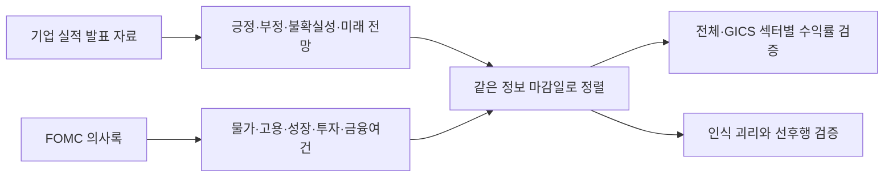

# 연준의 말, 기업의 말

**FOMC 의사록과 기업 실적 발표 자료를 결합하면 미국 주식 투자 판단이 나아질까?**

KAIST DFMBA 금융데이터 애널리틱스의 **Case 3 공시 수집·텍스트 추출**에서 출발한 연구입니다. 기업의 실적·전망을 읽는 바텀업 분석부터 검증하고, 연준의 경제 인식을 읽는 탑다운 분석을 더해 봅니다. 물가·고용·성장·투자·금융여건과 GICS 섹터별 차이, 두 출처의 인식이 엇갈릴 때의 선후행도 함께 살펴봅니다.

## 먼저 열어볼 자료

| 자료 | 용도 |
|---|---|
| [7분 제안 발표 PPT](presentations/proposal_7min.pptx) | 참고자료 디자인 반영. 데이터 출처 → 네 가설 → 점수화 → 4단계 도형 → 검증·투자 활용. 6장, 발표자 노트 포함 |
| [제안 발표 PDF](presentations/proposal_7min.pdf) | 현재 6장 PPT의 PDF 버전 |
| [현재 제안 발표 대본](docs/presentation_script_v2.md) | 6장·420초 시간 배분과 출처 |
| [HTML 결과 보고서](artifacts/result_report.html) | 파일을 내려받아 브라우저로 열기. 기업 검색, 주제·섹터 선택, 차트와 근거 데이터 확인 |
| [전수 분석 결과 PPT](presentations/results_full.pptx) | 현재 구성기업 전수 수집, 실제 분석 범위와 검증 결과 |
| [보존한 33개 기업 파일럿](presentations/results_pilot.pptx) | 전수 확대 전의 결과. HTML에서 지표 비교 가능 |
| [연구 계획 및 실행 방법론](docs/research_plan.md) | 가설, 공개 시점 처리, 모델 비교, 괴리 분석의 자세한 설계 |
| [데이터 출처와 점수 정의](docs/data_sources.md) | 원문 출처, 수집 규칙, 사전·모델, 컬럼 및 재현 방법 |
| [성과 개선을 위한 향후 과제](#향후-과제-성과-개선-가능성을-검증할-분석) | 시차·신선도·새 정보·경제 의미·투자 역할의 검증 계획 |
| [추가 개발 로드맵](docs/development_roadmap.md) | 우선순위, 팀 분업, 필요한 데이터와 검증 기준 |

GitHub는 HTML 파일을 웹페이지로 바로 실행하지 않습니다. 위 HTML의 **Download raw file**로 저장한 후 여세요. HTML에는 결과 데이터가 포함되어 있어 별도 서버 없이 읽을 수 있습니다. PPT는 다운로드 후 PowerPoint에서 열면 도형과 차트를 편집할 수 있습니다.

## 이번 실행 결과

<!-- RESULTS:START -->
전수 수집 대상: **503개 주식 클래스 / 500개 기업**. 수집 시도 **500개**, 원문 확보 **497개**, 시장 자료 매칭 **497개**, 분기 패널 포함 **497개**, 완결 수익률로 표본 외 평가에 포함된 기업 **495개**입니다. 기업 문서 **19,613건**과 FOMC 의사록 **81건**, **11개 섹터**를 포함합니다.

분석 대상은 2016–2025년이며, 실제 평가 가능한 표본 외 구간은 **26개 분기**입니다. 원자료의 공개 시점과 결과가 완성된 수익률만 사용합니다.

| 모델 | 평균 IC | 예측 오차(RMSE) | 평가 분기 |
|---|---:|---:|---:|
| 기본 통제변수 | 0.039 | 0.1573 | 26 |
| 바텀업 | 0.037 | 0.1574 | 26 |
| 탑다운 | 0.041 | 0.1670 | 26 |
| 결합 | 0.041 | 0.1671 | 26 |

- **현재 구성 발행사 전수 수집과 실제 분석 범위** 목표 500개 발행사 중 500개 수집 시도, 497개 문서 확보, 497개 분기 패널 연결, 495개 완결 수익률 표본외 평가입니다. 2016–2025년에 공개된 기업 문서 19,613건과 FOMC 81건을 처리했습니다. 현재 구성종목을 과거에 적용한 표본이므로 역사적 S&P 500 전체의 결과는 아닙니다.
- **수익률 오차와 종목 순위 예측력을 함께 평가한다** 26개 평가 분기에서 OOS RMSE가 가장 낮은 것은 기본 통제변수 모델(0.1573)입니다. 결합 모델 RMSE는 0.1671이며, 평균 순위 IC는 결합 0.0407, 탑다운 0.0408, 바텀업 0.0374입니다. 수익률 수준의 오차와 종목 순위는 다른 평가 기준입니다. 제한된 분기 표본의 탐색 결과로 모형 우월성이 확증된 것은 아닙니다.
- **다른 정보원이 어조 예측에 추가하는 정보** 전체 어조의 다음 분기 예측에서 자기 전기 값만 사용한 모형보다, 탑다운 정보를 추가한 바텀업 어조 RMSE는 1.03% 증가, 바텀업 정보를 추가한 탑다운 어조 RMSE는 3.49% 증가했습니다(27개 OOS 시점). 탐색적 차이이며 경제·실적 예측의 정확성이나 정보원의 우월성을 확증하지 않습니다.

롱숏 투자성과는 실제 보유기간 **2020-01~2025-12, 24개 분기**입니다. 선택 종목의 수익률이 누락된 분기는 전체 포트폴리오를 미산출 처리했으며, 수익률을 0으로 채우거나 나머지 종목으로 재가중하지 않았습니다. 예측 오차·IC의 평가 기간 및 기존 파일럿의 투자성과 평가 기간과 구분합니다.

LM·FinBERT 동일 문장 비교: **513개 문서 · 12,264개 문장**. 전체 코퍼스의 투자 수익률 비교는 수행하지 않았습니다.

정확한 수치와 근거는 [분석 결과 JSON](reports/results.json), [수집 현황](reports/data_coverage.json), HTML·결과 PPT에서 확인할 수 있습니다.
<!-- RESULTS:END -->

**여기서 전수는 고정한 현재 구성종목 스냅샷의 모든 기업을 수집 대상으로 삼았다는 뜻입니다.** 모든 기업에 10년치 문서·수익률이 존재한다는 뜻은 아닙니다. 위 결과와 [섹터별 연결 현황](reports/coverage_funnel.csv), [기업별 포함 여부](reports/issuer_coverage.csv)에서 원문 확보·패널 연결·완결 수익률 평가의 분모를 확인하세요. 현재 구성종목·현재 GICS를 과거에 적용하므로 생존편향이 남습니다. 과거 각 시점의 S&P 500 전체를 재현한 연구와는 구분합니다.

33개 기업 파일럿은 [원래 집계 결과](reports/pilot_baseline.json)와 `pilot-33-2026-10-31` Git 태그로 보존했습니다. 전수 점검에서는 일부 기존 파일럿에도 재무표·별도 첨부문서의 선택 오류가 있음을 확인해 교정했습니다. 따라서 파일럿은 원래 실행의 기록이며, 전수 판본과의 차이는 표본 확대와 원문 교정을 함께 반영합니다. 자료 교정은 `reports/corpus_repairs_full.json`에 기록합니다.

## 무엇을 검증하나



1. **바텀업의 유효성:** 기업 텍스트 점수가 이후 수익률 순위를 설명하는가?
2. **결합의 추가 가치:** 바텀업에 FOMC 정보를 추가하면 미래 구간의 예측이 개선되는가?
3. **주제와 섹터:** 어떤 주제를 제거했을 때 예측이 나빠지는가? 그 차이가 섹터마다 다른가?
4. **괴리와 선후행:** 기업과 연준의 어조가 엇갈릴 때 어느 쪽이 뒤따라 움직이는가? 다른 출처를 더하면 다음 어조의 예측 오차가 줄어드는가?

괴리의 해소, 다음 어조의 예측, 투자 수익률은 서로 다른 평가입니다. 어느 쪽 텍스트가 선행한다고 해서 곧바로 더 높은 투자 수익률을 얻는 것은 아닙니다.

## 실제로 실행한 분석

| 단계 | 실행 내용 | 읽을 때 주의할 점 |
|---|---|---|
| 원문 수집 | 연준 공식 의사록, SEC 공시의 실적 발표 자료와 검증된 기업 IR 보완 자료 | 실적 보도자료·실적 주주서한·공식 업데이트. 콘퍼런스콜 전문은 포함하지 않음 |
| 점수화 | LM 금융 사전의 긍정·부정·불확실성, 미래 전망 문장, 5개 주제 | 일반적인 어조는 물가·금리의 방향이나 매파·비둘기파 점수가 아님 |
| 문맥 모델 비교 | 동일 문장 표본을 LM과 FinBERT로 점수화 | 방법 간 일치도 확인. 사람 정답 대비 정확도·전체 수익률 검증은 별도 |
| 투자 패널 | 분기 말 공개된 최신 기업 문서·FOMC를 사용, 다음 3개월 수익률 연결 | 공개 시점 이후 정보와 아직 실현되지 않은 수익률은 학습에서 제외 |
| 예측 비교 | 기본 통제변수 / 바텀업 / 탑다운 / 결합의 시간 순서 표본 외 비교 | 과거 구간에서만 결측 처리·표준화·계수 추정 |
| 주제별 비교 | 해당 주제의 기업·FOMC 변수와 상호작용을 함께 제거 | 두 출처를 합친 추가 예측 기여. FOMC 단독 기여나 인과적 민감도 추정은 아님 |
| 전략 검증 | 예측 상위 1/3 롱·하위 1/3 숏, 거래대금당 10bp 차감 | 롱 100%·숏 100%. 대차료·조달비용·시장충격 제외 |
| 괴리 분석 | 과거 분포 기준 어조 격차와 다음 분기 변화, 양방향 예측 오차 비교 | 수렴 유형은 사후 해석에만 사용하며 과거 매매 신호에 넣지 않음 |

**지표 읽기:** IC는 예측 순위와 실제 수익률 순위의 상관입니다. RMSE는 예측 오차로 낮을수록 좋습니다. 주제 제거 후 RMSE 증가율이 양수이면 그 주제별 변수가 예측에 보탬이 되었다는 뜻입니다. 선후행 표의 오차 감소율은 다른 출처의 어조를 추가했을 때의 개선율입니다. 어느 지표든 제한된 분기와 현재 구성기업 표본에서 얻은 탐색 결과입니다.

수익률 목표는 개별 주식의 3개월 복리수익률에서 같은 기간 광범위한 미국 주식시장의 복리수익률을 뺀 BHAR입니다. S&P 500 대비 수익률 또는 팩터 알파와 동일하지 않습니다. 거시 정보는 같은 분기의 모든 기업에 공통이므로 기업 행 수를 독립적인 거시 관측 수로 해석하지 않습니다.

## 폴더 안내

```text
artifacts/              내려받아 열 수 있는 단일 HTML 결과물
presentations/          제안 발표 및 실행 결과 PPT
docs/                   연구 설계·발표 대본·데이터 설명·검증 기록
configs/                기업 표본·주제 키워드·연구 설정
src/topbottom/          수집, 텍스트 점수화, 수익률 및 모델 분석
scripts/                단계별 실행 명령
tests/                  공개 시점·수익률·학습 누수 등 의미 있는 검증
data/reference/         구성종목 스냅샷·선정 표본·사전 해시
data/processed/         공개 원문에서 도출한 점수·출처 목록
reports/                공개 가능한 집계 분석 결과 JSON·CSV
report-app/             HTML 보고서의 React 소스와 Data App 런타임
```

`data/raw/`, `data/cache/`, `data/private/`, `models/`, `.env`는 Git에서 제외합니다. **수업용 CRSP 원자료, 개별 주식 수익률 패널, 사전 원본, 모델 가중치, SEC 요청용 개인 연락처를 업로드하지 않습니다.** 공개 결과만으로 보고서를 읽을 수 있지만 수익률 분석을 다시 실행하려면 본인의 사용 권한이 있는 시장 데이터가 필요합니다.

## 재현하기

Python 3.11 이상을 사용합니다. 아래 명령은 저장소 최상위에서 실행합니다.

```powershell
git clone https://github.com/qkryung/DFMBA_FDA_Top-Bottom-Analysis.git
cd DFMBA_FDA_Top-Bottom-Analysis
python -m venv .venv
.\.venv\Scripts\Activate.ps1
python -m pip install -r requirements.txt
python -m pytest -q
```

**1. 공개 문서 수집과 점수화**

```powershell
# SEC에 본인의 실제 이름과 연락처를 제공합니다. 이 값을 Git에 저장하지 마세요.
$env:SEC_USER_AGENT = 'YOUR ACTUAL NAME YOUR CONTACT EMAIL'
python scripts/collect_data.py --scope full --dictionary-zip 'PATH_TO_AUTHORIZED_DICTIONARY_ZIP'
python scripts/recover_corpus.py
python scripts/finalize_source_repairs.py
python scripts/score_text.py --changed-only
python scripts/audit_corpus.py
```

사전은 로컬 수업 자료 `Dictionaries20200204.zip` 형식을 사용합니다. 실제 사용 사전의 해시는 `data/reference/dictionary_manifest.json`에 있습니다. `.env.example`은 설정 예시이며 `.env`를 자동으로 읽지는 않습니다. 필요한 환경변수는 직접 설정합니다. SEC 수집기는 전체 요청 속도를 제한하고 캐시를 재사용합니다. 여러 전체 수집기를 동시에 실행하지 마세요.

같은 수집 명령을 다시 실행하면 완료한 기업·문서 체크포인트를 이어받습니다. 진행 상태는 `data/processed/issuer_collection_status.csv`에서 확인합니다. 특정 기업만 다시 점검할 때에는 `--scope full --tickers TICKER1,TICKER2 --force-issuers`를 사용합니다. `--refresh-universe`는 모집단을 바꾸므로 원래 실행의 재현에는 사용하지 않습니다. 빠른 소규모 동작 점검에는 `--scope pilot`을 사용할 수 있습니다.

복구 단계는 검토된 과거 CIK·첨부문서 예외를 적용하고, 자료가 없는 달력 분기에서 공시 메타데이터 오류를 제한적으로 점검합니다. 실제 본문과 실적 첨부를 모두 확인하며, 신규 상장 이전 기간이나 관련 없는 문서로 빈 분기를 채우지 않습니다. 원문 선택·제외의 근거는 `configs/source_recovery.json`, `data/processed/excluded_exhibits.csv`, `reports/corpus_repairs_full.json`에 남깁니다.

`finalize_source_repairs.py`는 검토를 마친 공시의 교정·제외 결정을 재현합니다. 범위에 맞는 대체 발표문을 확인하지 못한 공시도 제외하며, 해당 기업에 실적 발표 자체가 없었다는 뜻은 아닙니다.

기업 자료는 주로 8-K·6-K 첨부문서입니다. 본문에 삽입된 실적 보도자료, 다른 SEC 서식의 실적 첨부문서, 이미지 실적자료와 매칭되는 공식 IR 텍스트는 검증된 예외로 복구합니다. 실제 사용한 원문 URL과 SEC 공시 연결, 추출 범위를 출처 목록에 표시합니다. FOMC는 회의 연도가 아니라 실제 공개일을 기준으로 범위를 정합니다.

공식 IR 보완 원문의 공개 시간이 날짜로만 확인되면 미국 동부시간 기준 발표일 다음 날 00:00부터 가용하다고 처리하고, 원래 SEC 접수 시각이 더 늦으면 그 시각을 사용합니다. 원문 접수 시각과 분석 가용 시각은 별도로 보존합니다.

**2. 허가된 수익률 자료로 분석**

```powershell
# 수집·원문 감사를 마친 뒤 최종 결과를 교체합니다.
python scripts/run_analysis.py --scope full --final --crsp 'PATH_TO_CRSP_CIZ_MONTHLY_CSV' --factors 'PATH_TO_FF_FACTORS_CSV'
# 최초 준비 이후에는 로컬 private 캐시를 재사용합니다.
python scripts/run_analysis.py --scope full --final
python scripts/validate_results.py
```

CRSP CIZ 월별 파일의 `Ticker`, `PERMNO`, `MthCalDt`, `MthRet` 등 필요한 컬럼은 코드와 [방법론](docs/research_plan.md)을 확인하세요. 코드가 기대하는 형식과 다른 자료는 먼저 명시적으로 변환해야 합니다. 공개 저장소에는 재배포 권한이 없는 원자료를 포함하지 않습니다.

`--final` 없는 전수 실행은 중간 결과를 `reports/full_checkpoint/`에 저장해 공개 최종 결과를 보존합니다. 전수 수익률 캐시는 `data/private/full/`에 따로 저장합니다. 티커 변경·신규 분할은 [기업 식별 검토](docs/issuer_identity_review.md)와 `configs/market_identity.json`에 근거를 남겼습니다.

**3. 선택적 FinBERT 비교**

```powershell
python -m pip install -r requirements-finbert.txt
python scripts/score_finbert_sample.py --revision 0bc2ac10dda6929bcb1f77ccc43c7ec5c424f031
```

모델을 처음 실행하면 외부 가중치를 다운로드합니다. 최신 기업 문서와 2024–2025년 FOMC 문서에서 문서당 최대 24개 문장을 표본으로 사용합니다. 전체 문서에 대한 FinBERT 수익률 백테스트를 실행하는 명령은 아닙니다.

**4. 보고서와 PPT 갱신**

```powershell
python scripts/update_readme_results.py
python scripts/build_html.py --data-plugin-root 'PATH_TO_INSTALLED_DATA_ANALYTICS_PLUGIN'
```

HTML 재생성에는 Node와 Data Analytics 플러그인의 검증된 런타임이 필요합니다. `--data-plugin-root`를 생략하면 로컬 설치 경로에서 탐색합니다. `report-app/src/content/`가 보고서 화면, `scripts/build_report.py`가 결과 데이터 연결부입니다. 동봉된 단일 HTML을 읽는 데에는 이 개발 도구가 필요하지 않습니다.

```powershell
# PPT 재생성: Windows + Microsoft PowerPoint + pywin32 필요
python -m pip install pywin32
python scripts/build_slides.py --full-results reports/results.json
```

PPT 생성 옵션과 산출물은 [발표 자료 안내](presentations/README.md)를 확인하세요. 이미 만들어 둔 PPT를 열 때에는 Python이 필요하지 않습니다.

**5. 수집 상태와 전수 결과 점검**

```powershell
python scripts/validate_results.py
python scripts/verify_outputs.py
```

전수 수집은 네트워크와 SEC 문서 수에 따라 오래 걸립니다. 수집 오류·동일 발행사 중복·과거 CIK 변경·문서 유형을 검토한 뒤 분석하세요. 최종 검증은 결과 JSON, 공개 점수, HTML, PPT의 분모와 지표를 서로 대조합니다. 로컬 수익률 자료가 있으면 예측 오차와 시점 조건도 독립적으로 재계산합니다. 현재 구성종목 전수 분석만으로 생존편향이 사라지지는 않습니다. 엄밀한 후속 검증에는 시점별 과거 S&P 500 구성종목과 당시 GICS가 필요합니다.

## 향후 과제: 성과 개선 가능성을 검증할 분석

**시차가 성과를 약화시켰을 가능성은 있지만, 현재 결과만으로 주원인이라고 결론낼 수는 없습니다.** 현재 분석은 분기 말까지 공개된 최신 기업 문서와 FOMC 의사록을 연결해 다음 3개월 수익률을 예측합니다. 발표부터 분기 말까지의 주가 반응은 이 수익률에 포함되지 않습니다. 따라서 발표 직후에만 유효한 신호라면 현재 방식에서는 약하게 나타날 수 있습니다. 이미 가격에 반영된 정보라면 진입 시점을 앞당겨도 실행 가능한 추가 수익은 없을 수 있습니다.

FOMC 정례회의 의사록은 정책 결정 후 통상 약 3주 뒤에 공개됩니다. 의사록의 회의일을 매매 신호 발생일로 당겨 쓰면 당시 공개되지 않은 정보를 사용하는 오류가 됩니다. 기업 IR의 최초 발표 시각과 SEC 접수 시각도 별도로 확인해야 합니다. 현재 월별 수익률 자료만으로는 발표 직후 며칠의 효과를 검증할 수 없어, 일별 가격과 정확한 공개 시각 확보가 선행 과제입니다. [연준 공개 일정 안내](https://www.federalreserve.gov/monetarypolicy/fomccalendars.htm), [SEC Form 8-K](https://www.sec.gov/files/form8-k.pdf)

아래는 **아직 실행하지 않은 후속 실험**입니다. 성과 개선을 보장하는 방법이 아니라, 신호가 약한 이유와 실제 투자에 사용할 수 있는 조건을 구분하기 위한 계획입니다.

| 우선순위 | 검증할 질문 | 제안하는 분석 | 확인할 결과 |
|---|---|---|---|
| 1. 발표 시점과 보유기간 | 분기 말까지 기다리면서 유효한 신호를 놓치는가? | 정확한 공개 시각·거래일·일별 가격을 연결합니다. 발표 직전 가격부터의 즉각 반응은 설명용으로 측정하고, 공개 후 체결 가능한 가격에서 시작하는 1·5·20·60거래일 수익률은 별도로 검증합니다. | 신호가 언제 반영되고 얼마나 유지되는지, 진입 지연과 거래비용을 반영해도 남는지 |
| 2. 정보의 신선도와 갱신 빈도 | 오래된 문서와 서로 다른 시점의 기업·연준 전망을 결합해 신호가 흐려지는가? | 양쪽 문서의 공개 후 경과일과 공개일 차이를 기록합니다. 경과일 제한·시간 감쇠 가중, 월별·분기별 갱신, 새 문서 공개 때 갱신하는 방식을 공통 표본에서 비교합니다. | 신선도에 따른 IC·수익률 차이, 기업·섹터 구성 변화로 생긴 차이인지 여부 |
| 3. FOMC의 새로운 정보 | 전체 어조보다 시장이 새로 알게 된 내용이 중요한가? | 전 의사록 대비 변화와 같은 회의의 성명·기자회견·경제전망(발표된 회의에 한함) 대비 추가 내용을 분리하고 각 자료의 실제 공개 시점을 적용합니다. | 이미 공개된 정보에 의사록이 더하는 예측력. 사전 기대 자료가 없으면 텍스트 변화를 시장의 ‘서프라이즈’라고 부르지 않음 |
| 4. 경제적 의미와 숫자 정보 | 긍정 어조가 미래 실적 개선을 뜻하는가? | 경영진 설명·가이던스를 재무표·상용구와 분리하고, 실현 실적/미래 전망·수요/비용·상향/하향을 사람 라벨로 검증합니다. 매출·EPS·가이던스 변화 통제 후 같은 문서·기간에서 LM과 FinBERT를 비교합니다. | 기본 모형 → 수치 실적 모형 → 수치+텍스트 모형의 추가 예측력. 현재 FinBERT의 방법 간 일치도 비교를 수익률 검증으로 확대 |
| 5. 두 정보의 역할과 괴리 | 탑다운과 바텀업을 어디에 활용해야 하는가? | 바텀업은 섹터 내 종목선정, 탑다운은 섹터 상대수익률·비중 조절로 나누어 검증합니다. 같은 주제·전망 기간의 괴리에서 기업 추종·연준 추종·중립 유지 규칙을 사전에 정해 비교합니다. | 어조의 선후행, 실제 실적·거시지표 전망의 정확성, 비용 후 투자성과를 별도 평가. 거시지표는 당시 이용 가능한 최초 발표치를 사용 |
| 6. 모형과 재현성 | 변수 수·규제 강도·표본 선택이 결과를 좌우하는가? | 단순 점수 순위부터 비교하고, Ridge 규제 강도는 학습 구간 내부의 시간순 검증에서 선택합니다. 역사적 구성종목·당시 GICS, 출처별 주제 제거, 비용 0·10·25·50bp와 회전율을 점검합니다. | 소수 변수의 효과가 여러 기간·비용 조건에서 유지되는지, 특정 섹터나 시기에 집중되는지 |

**첫 실행 묶음은 ‘공개 시점·경과일 점검 → 발표 기준 단기 검증 → 분기 전략과 비교’입니다.** 공개 시각이 불명확한 자료는 보수적으로 처리하고, 장 마감 후 발표는 다음 거래 가능 시점부터 평가합니다. 단기 반응이 있어도 그 반응 이후에 매수한 전략의 수익과 혼동하지 않습니다. 일별 자료를 확보하기 전에는 기존 월별 자료로 월별·분기별 갱신과 경과일 민감도부터 점검할 수 있습니다.

거시 변화가 기업 실적과 가격에 전달되는 데 시간이 걸리는 가설도 함께 검증합니다. 같은 주제·전망 기간을 맞춘 뒤 사전에 정한 1·3·6개월 보유기간과 제한된 과거 시차를 비교합니다. 이를 통해 발표 반응을 놓친 것인지, 효과가 늦게 나타나는 것인지 구분합니다. 학습에는 예측 시점까지 결과가 완결된 수익률만 포함합니다.

비교는 가능한 한 같은 기업·기간·정보 집합과 같은 기준 모형에서 한 요소씩 바꿉니다. 표본이 달라지면 공통 표본 결과와 제외 범위를 함께 남깁니다. IC, RMSE, 비용 후 성과·회전율을 같이 보고, 단기 보유기간이 겹치는 관측과 같은 FOMC 발표일의 기업 관측을 독립 표본으로 세지 않습니다. 여러 보유기간·섹터를 시험할 때에는 기간 단위 검증과 다중검정을 적용합니다.

**이미 결과를 본 2016–2025년 자료로 후속 설계를 고르면 그 결과는 추가 탐색입니다.** 개선 여부의 최종 판정에는 새로 확보한 미사용 기간 또는 아직 보지 않은 평가 표본을 남기고, 설계·지표·비용 가정을 먼저 고정합니다. 기존 전수 결과는 비교 기준으로 보존합니다.

세부 라벨 설계, 팀 분업, 필요한 데이터와 완료 기준은 [개발 로드맵](docs/development_roadmap.md)에 있습니다. 과거 구성종목·당시 GICS 확보는 모든 단계의 공통 데이터 과제입니다.

자동 검증은 `.github/workflows/checks.yml`에서 수행합니다. 빌드 및 화면 검증의 실제 수행 범위는 [검증 기록](docs/validation.md)에 남깁니다. 외부 데이터와 모델은 각 제공자의 이용 조건을 따릅니다.
