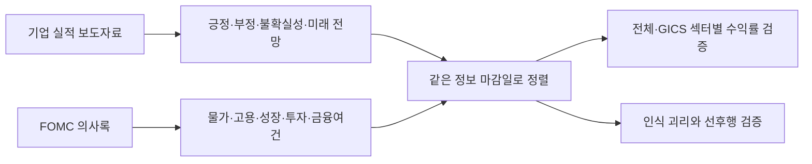

# 연준의 말, 기업의 말

**FOMC 의사록과 기업 실적 보도자료를 결합하면 미국 주식 투자 판단이 나아질까?**

KAIST DFMBA 금융데이터 애널리틱스의 **Case 3 공시 수집·텍스트 추출**에서 출발한 연구입니다. 기업의 실적·전망을 읽는 바텀업 분석부터 검증하고, 연준의 경제 인식을 읽는 탑다운 분석을 더해 봅니다. 물가·고용·성장·투자·금융여건과 GICS 섹터별 차이, 두 출처의 인식이 엇갈릴 때의 선후행도 함께 살펴봅니다.

## 먼저 열어볼 자료

| 자료 | 용도 |
|---|---|
| [7분 제안 발표 PPT](presentations/proposal_7min.pptx) | 연구 배경 → 질문 → 데이터 → 분석 방법 → 기대 결과. 9장, 발표자 노트 포함 |
| [제안 발표 대본](docs/presentation_script.md) | 슬라이드별 시간과 발표 내용 |
| [HTML 결과 보고서](artifacts/result_report.html) | 파일을 내려받아 브라우저로 열기. 주제·섹터 선택, 차트와 근거 데이터 확인 |
| [실행 결과 PPT](presentations/results_pilot.pptx) | 실제 수집 범위, 검증 결과와 한계 요약 |
| [연구 계획 및 실행 방법론](docs/research_plan.md) | 가설, 공개 시점 처리, 모델 비교, 괴리 분석의 자세한 설계 |
| [데이터 출처와 점수 정의](docs/data_sources.md) | 원문 출처, 수집 규칙, 사전·모델, 컬럼 및 재현 방법 |

GitHub는 HTML 파일을 웹페이지로 바로 실행하지 않습니다. 위 HTML의 **Download raw file**로 저장한 후 여세요. HTML에는 결과 데이터가 포함되어 있어 별도 서버 없이 읽을 수 있습니다. PPT는 다운로드 후 PowerPoint에서 열면 도형과 차트를 편집할 수 있습니다.

## 이번 실행 결과

<!-- RESULTS:START -->
실행 범위: **33개 기업 · 11개 섹터 · 기업 문서 1,334건 · FOMC 의사록 80건**.

분석 대상은 2016–2025년이며, 실제 평가 가능한 표본 외 구간은 **26개 분기**입니다. 원자료의 공개 시점과 결과가 완성된 수익률만 사용합니다.

| 모델 | 평균 IC | 예측 오차(RMSE) | 평가 분기 |
|---|---:|---:|---:|
| 기본 통제변수 | -0.001 | 0.1285 | 26 |
| 바텀업 | -0.022 | 0.1293 | 26 |
| 탑다운 | 0.049 | 0.1408 | 26 |
| 결합 | 0.053 | 0.1418 | 26 |

- **실제 자료로 실행한 탐색적 파일럿** 33개 기업·11개 섹터, 기업 문서 1,334건과 FOMC 80건을 처리했습니다. S&P 500 전체의 결론으로 확대할 수 없습니다.
- **수익률 오차와 종목 순위는 다른 결과를 보인다** 26개 평가 분기에서 OOS RMSE가 가장 낮은 것은 기본 통제변수 모델(0.1285)입니다. 결합 모델 RMSE는 0.1418이며, 평균 순위 IC는 결합 0.0535, 탑다운 0.0492, 바텀업 -0.0225입니다. 수익률 수준의 오차와 종목 순위는 다른 평가 기준입니다. 제한된 분기 표본의 탐색 결과로 모형 우월성이 확증된 것은 아닙니다.
- **어조의 선행 정보 차이는 작다** 전체 어조의 다음 분기 예측에서 자기 전기 값만 사용한 모형보다, 탑다운 정보를 추가한 바텀업 어조 RMSE는 2.32% 감소, 바텀업 정보를 추가한 탑다운 어조 RMSE는 1.55% 증가했습니다(27개 OOS 시점). 작은 탐색적 차이이며 경제·실적 예측의 정확성이나 정보원의 우월성을 확증하지 않습니다.

LM·FinBERT 동일 문장 비교: **49개 문서 · 1,173개 문장**. 전체 코퍼스의 투자 수익률 비교는 수행하지 않았습니다.

정확한 수치와 근거는 [분석 결과 JSON](reports/results.json), [수집 현황](reports/data_coverage.json), HTML·결과 PPT에서 확인할 수 있습니다.
<!-- RESULTS:END -->

**목표 모집단은 S&P 500 전체입니다. 이번 실행본은 섹터별 3개씩 선정한 33개 기업의 파일럿이며, 500개 기업 전체 분석을 완료한 결과가 아닙니다.** 현재 구성종목·현재 GICS를 과거에 적용하므로 생존편향과 표본 선택의 영향이 있습니다. 모든 섹터를 포함했다는 것과 각 섹터를 대표한다는 것은 다릅니다.

## 무엇을 검증하나



1. **바텀업의 유효성:** 기업 텍스트 점수가 이후 수익률 순위를 설명하는가?
2. **결합의 추가 가치:** 바텀업에 FOMC 정보를 추가하면 미래 구간의 예측이 개선되는가?
3. **주제와 섹터:** 어떤 주제를 제거했을 때 예측이 나빠지는가? 그 차이가 섹터마다 다른가?
4. **괴리와 선후행:** 기업과 연준의 어조가 엇갈릴 때 어느 쪽이 뒤따라 움직이는가? 다른 출처를 더하면 다음 어조의 예측 오차가 줄어드는가?

괴리의 해소, 다음 어조의 예측, 투자 수익률은 서로 다른 평가입니다. 어느 쪽 텍스트가 선행한다고 해서 곧바로 더 높은 투자 수익률을 얻는 것은 아닙니다.

## 실제로 실행한 분석

| 단계 | 실행 내용 | 읽을 때 주의할 점 |
|---|---|---|
| 원문 수집 | 연준 공식 의사록, SEC 8-K Item 2.02의 실적 EX-99 첨부문서 | 기업 자료는 콘퍼런스콜 전문이 아닌 실적 보도자료 |
| 점수화 | LM 금융 사전의 긍정·부정·불확실성, 미래 전망 문장, 5개 주제 | 일반적인 어조는 물가·금리의 방향이나 매파·비둘기파 점수가 아님 |
| 문맥 모델 비교 | 동일 문장 표본을 LM과 FinBERT로 점수화 | 방법 간 일치도 확인. 사람 정답 대비 정확도·전체 수익률 검증은 별도 |
| 투자 패널 | 분기 말 공개된 최신 기업 문서·FOMC를 사용, 다음 3개월 수익률 연결 | 공개 시점 이후 정보와 아직 실현되지 않은 수익률은 학습에서 제외 |
| 예측 비교 | 기본 통제변수 / 바텀업 / 탑다운 / 결합의 시간 순서 표본 외 비교 | 과거 구간에서만 결측 처리·표준화·계수 추정 |
| 주제별 비교 | 결합 모델에서 주제별 변수를 하나씩 제거 | 추가 예측력 비교이며 인과적 민감도 추정이 아님 |
| 전략 검증 | 예측 상위 1/3 롱·하위 1/3 숏, 거래대금당 10bp 차감 | 롱 100%·숏 100%. 대차료·조달비용·시장충격 제외 |
| 괴리 분석 | 과거 분포 기준 어조 격차와 다음 분기 변화, 양방향 예측 오차 비교 | 수렴 유형은 사후 해석에만 사용하며 과거 매매 신호에 넣지 않음 |

**지표 읽기:** IC는 예측 순위와 실제 수익률 순위의 상관입니다. RMSE는 예측 오차로 낮을수록 좋습니다. 주제 제거 후 RMSE 증가율이 양수이면 그 주제별 변수가 예측에 보탬이 되었다는 뜻입니다. 선후행 표의 오차 감소율은 다른 출처의 어조를 추가했을 때의 개선율입니다. 어느 지표든 짧고 작은 선택 표본에서 얻은 탐색 결과입니다.

수익률 목표는 개별 주식의 3개월 복리수익률에서 같은 기간 광범위한 미국 주식시장의 복리수익률을 뺀 BHAR입니다. S&P 500 대비 수익률 또는 팩터 알파와 동일하지 않습니다. 거시 정보는 같은 분기의 모든 기업에 공통이므로 기업 행 수를 독립적인 거시 관측 수로 해석하지 않습니다.

## 폴더 안내

```text
artifacts/              내려받아 열 수 있는 단일 HTML 결과물
presentations/          제안 발표 및 실행 결과 PPT
docs/                   연구 설계·발표 대본·데이터 설명·검증 기록
configs/                기업 표본·주제 키워드·연구 설정
src/topbottom/          수집, 텍스트 점수화, 수익률 및 모델 분석
scripts/                단계별 실행 명령
tests/                  공개 시점·수익률·학습 누수 등 의미 있는 검증
data/reference/         구성종목 스냅샷·선정 표본·사전 해시
data/processed/         공개 원문에서 도출한 점수·출처 목록
reports/                공개 가능한 집계 분석 결과 JSON·CSV
report-app/             HTML 보고서의 React 소스와 Data App 런타임
```

`data/raw/`, `data/cache/`, `data/private/`, `models/`, `.env`는 Git에서 제외합니다. **수업용 CRSP 원자료, 개별 주식 수익률 패널, 사전 원본, 모델 가중치, SEC 요청용 개인 연락처를 업로드하지 않습니다.** 공개 결과만으로 보고서를 읽을 수 있지만 수익률 분석을 다시 실행하려면 본인의 사용 권한이 있는 시장 데이터가 필요합니다.

## 재현하기

Python 3.11 이상을 사용합니다. 아래 명령은 저장소 최상위에서 실행합니다.

```powershell
git clone https://github.com/qkryung/DFMBA_FDA_Top-Bottom-Analysis.git
cd DFMBA_FDA_Top-Bottom-Analysis
python -m venv .venv
.\.venv\Scripts\Activate.ps1
python -m pip install -r requirements.txt
python -m pytest -q
```

**1. 공개 문서 수집과 점수화**

```powershell
# SEC에 본인의 실제 이름과 연락처를 제공합니다. 이 값을 Git에 저장하지 마세요.
$env:SEC_USER_AGENT = 'YOUR ACTUAL NAME YOUR CONTACT EMAIL'
python scripts/collect_data.py --scope pilot --dictionary-zip 'PATH_TO_AUTHORIZED_DICTIONARY_ZIP'
python scripts/audit_corpus.py
python scripts/score_text.py
```

사전은 로컬 수업 자료 `Dictionaries20200204.zip` 형식을 사용합니다. 실제 사용 사전의 해시는 `data/reference/dictionary_manifest.json`에 있습니다. `.env.example`은 설정 예시이며 `.env`를 자동으로 읽지는 않습니다. 필요한 환경변수는 직접 설정합니다. SEC 수집기는 전체 요청 속도를 제한하고 캐시를 재사용합니다. 여러 전체 수집기를 동시에 실행하지 마세요.

**2. 허가된 수익률 자료로 분석**

```powershell
python scripts/run_analysis.py --crsp 'PATH_TO_CRSP_CIZ_MONTHLY_CSV' --factors 'PATH_TO_FF_FACTORS_CSV'
# 최초 준비 이후에는 로컬 private 캐시를 재사용합니다.
python scripts/run_analysis.py
python scripts/validate_results.py
```

CRSP CIZ 월별 파일의 `Ticker`, `PERMNO`, `MthCalDt`, `MthRet` 등 필요한 컬럼은 코드와 [방법론](docs/research_plan.md)을 확인하세요. 코드가 기대하는 형식과 다른 자료는 먼저 명시적으로 변환해야 합니다. 공개 저장소에는 재배포 권한이 없는 원자료를 포함하지 않습니다.

**3. 선택적 FinBERT 비교**

```powershell
python -m pip install -r requirements-finbert.txt
python scripts/score_finbert_sample.py --revision 0bc2ac10dda6929bcb1f77ccc43c7ec5c424f031
```

모델을 처음 실행하면 외부 가중치를 다운로드합니다. 최신 기업 문서와 2024–2025년 FOMC 문서에서 문서당 최대 24개 문장을 표본으로 사용합니다. 전체 문서에 대한 FinBERT 수익률 백테스트를 실행하는 명령은 아닙니다.

**4. 보고서와 PPT 갱신**

```powershell
python scripts/update_readme_results.py
python scripts/build_html.py --data-plugin-root 'PATH_TO_INSTALLED_DATA_ANALYTICS_PLUGIN'
```

HTML 재생성에는 Node와 Data Analytics 플러그인의 검증된 런타임이 필요합니다. `--data-plugin-root`를 생략하면 로컬 설치 경로에서 탐색합니다. `report-app/src/content/`가 보고서 화면, `scripts/build_report.py`가 결과 데이터 연결부입니다. 동봉된 단일 HTML을 읽는 데에는 이 개발 도구가 필요하지 않습니다.

```powershell
# PPT 재생성: Windows + Microsoft PowerPoint + pywin32 필요
python -m pip install pywin32
python scripts/build_slides.py --results reports/results.json
```

PPT 생성 옵션과 산출물은 [발표 자료 안내](presentations/README.md)를 확인하세요. 이미 만들어 둔 PPT를 열 때에는 Python이 필요하지 않습니다.

**5. S&P 500 전체로 확장**

```powershell
python scripts/collect_data.py --scope full
python scripts/audit_corpus.py
python scripts/score_text.py
python scripts/run_analysis.py --crsp 'PATH_TO_CRSP_CIZ_MONTHLY_CSV' --factors 'PATH_TO_FF_FACTORS_CSV'
```

전수 수집은 네트워크와 SEC 문서 수에 따라 오래 걸립니다. 수집 오류·동일 발행사 중복·과거 CIK 변경·문서 유형을 검토한 뒤 분석하세요. 현재 구성종목을 확장하는 것만으로 생존편향이 사라지지는 않습니다. 엄밀한 후속 검증에는 시점별 과거 S&P 500 구성종목과 당시 GICS가 필요합니다.

## 팀에서 이어갈 일

- **데이터:** 시점별 구성종목과 CIK 이력, 실적 발표 시각, 서프라이즈·회계 실적 통제변수 확보.
- **텍스트:** 사람이 확인한 문장 표본으로 주제·방향·가이던스 라벨을 검증하고 FinBERT를 전체 코퍼스로 확장.
- **검증:** 더 긴 기간·더 큰 표본, 고정된 최종 검증 기간, 다중검정 보정, 거래비용·대차 가능성을 반영.
- **발표:** 제안 발표는 연구 질문과 설계를 설명하고, 결과 발표는 실행 범위·관측값·한계를 설명.

자동 검증은 `.github/workflows/checks.yml`에서 수행합니다. 빌드 및 화면 검증의 실제 수행 범위는 [검증 기록](docs/validation.md)에 남깁니다. 외부 데이터와 모델은 각 제공자의 이용 조건을 따릅니다.
